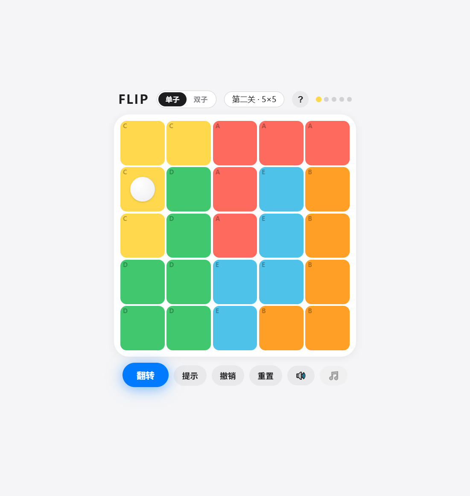
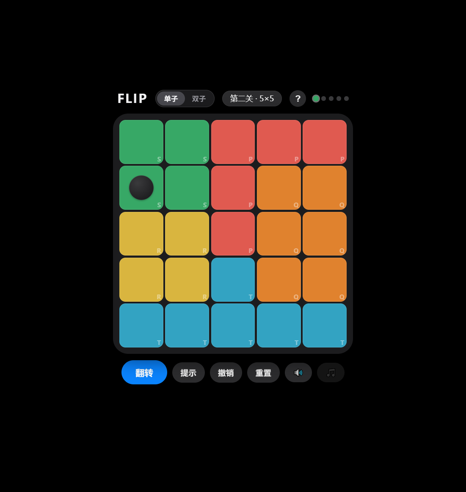
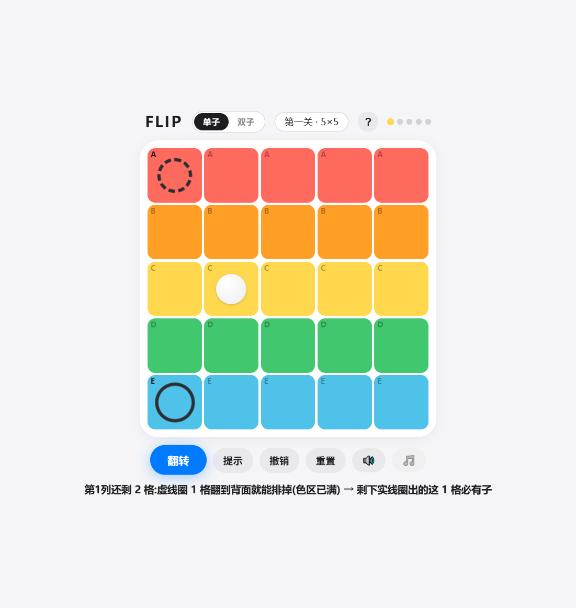
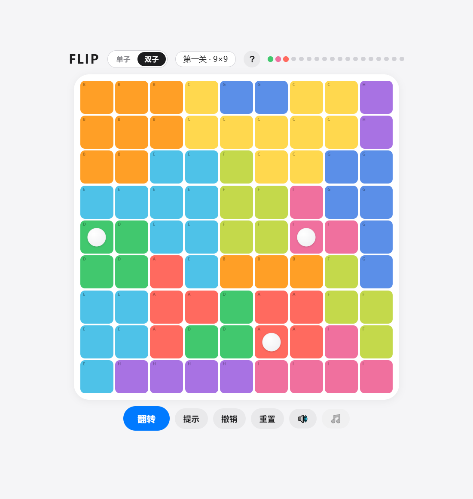

# FLIP · 双面约束解谜

> 翻一面棋盘,换一套逻辑——单面推不动时,答案在另一面。

单文件 H5 解谜游戏:棋盘有**正反两面**,每面各有一套行、列与色区约束,落子必须同时满足两面的所有约束。正面推一步,背面接一步。**50 个单子关卡 + 20 个双子关卡**,每一关都由内置同构求解器验证:纯逻辑可解、解唯一,永不猜。

| 正面 | 翻面 |
|:---:|:---:|
|  |  |
| 提示:实线圈=必放,虚线圈=可排除 | 双子模式:每区 2 子 + 不相邻 |
|  |  |

## 玩法

- 点一下格子标 **✕**(排除),再点一下落子;顶栏「翻转」切换正反两面
- 每行 / 每列 / 每个色区都要放满指定数量的子(单子模式每区恰 1 子,双子模式 2 子),且任两子不相邻
- 卡住时点**「提示」**:它不直接给答案,而是用**实线圈**标出必放候选、**虚线圈**标出「翻面即可排除」的格——把跨面推理的心法说破,而不是替玩家默默排掉
- 手机 / PC 通用,单指操作,进度自动保存在浏览器本地

## 技术特点

- **单文件 81 KB**:零外部资源、零构建、零依赖——一个 HTML 包含全部玩法、美术、动画与音效,任何静态托管点开即玩
- **关卡可解性由数学保证**:生成器与游戏共用同一套推理引擎(单候选、鸽笼包含、跨面排除、相邻窒息),70 关全部经求解器验证:有唯一解、单面视角必然卡死(翻转不可绕过)
- **提示系统 = 求解器本体**:不是事后解释,而是把每一步推理显式化教给玩家;计数只以玩家当前视角可见的排除为准,报出的数字当场可验证
- **程序化 lo-fi 音效**:WebAudio 实时合成,无音频文件
- **17 轮真人反馈迭代**:全部改动以可重放补丁脚本落地(锚定 + 断言,失败不写盘),配 33 个版本回滚点与全量回归测试

## 运行

无需安装:浏览器打开 `index.html` 即玩。部署到任意静态托管(GitHub Pages / Vercel / Netlify)即可分享在线链接。

## 目录

```
index.html   游戏本体(单文件,自包含)
shots/       截图
```
